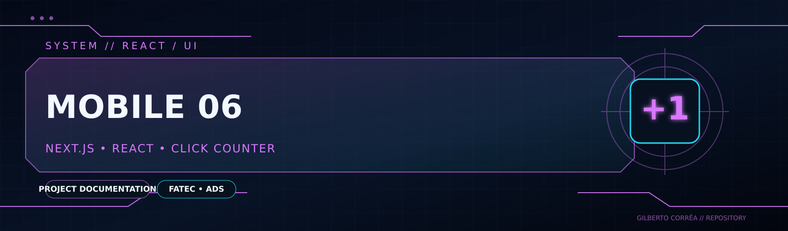
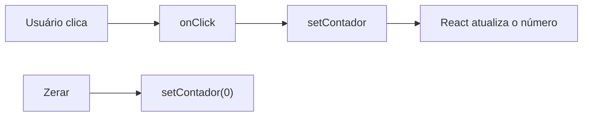

<div align="center">
  
</div>

<div align="center">

# M O B I L E　0 6　//　C L I C K　C O U N T E R

### `NEXT.JS • REACT • USESTATE • CSS MODULES`

**Exercício de interface web em Next.js com contador de cliques, atualização de estado e opção de zerar a contagem.**


`ADS` · `FATEC` · `PROJETO ACADÊMICO`

[Visão geral](#visao-geral) · [Estrutura](#estrutura) · [Arquitetura](#arquitetura) · [Execução](#execucao)

</div>

---

<a id="visao-geral"></a>

## `PROJECT // VISÃO GERAL`

Exercício de interface web em Next.js com contador de cliques, atualização de estado e opção de zerar a contagem.

## `SYSTEM // STATUS`

| Recurso | Situação |
| :--- | :---: |
| Código fonte | `● DISPONÍVEL` |
| Documentação | `● DOCUMENTADA` |
| Publicação em produção | `◉ NÃO VERIFICADA` |

<a id="estrutura"></a>

## `STRUCTURE // ARQUIVOS E MÓDULOS`

| Arquivo / pasta | Responsabilidade |
| :--- | :--- |
| [`pages/index.jsx`](pages/index.jsx) | Componente React e lógica do contador com `useState` |
| [`styles/Contador.module.css`](styles/Contador.module.css) | Estilização do contador |
| [`package.json`](package.json) | Scripts `dev`, `build` e `start` |

<a id="arquitetura"></a>

## `ARCHITECTURE // FLUXO`



<a id="execucao"></a>

## `BOOT SEQUENCE // COMO EXECUTAR`

```bash
git clone https://github.com/gilbertocorrea-cmd/mobile06.git
cd mobile06
```

**Executar localmente:** `npm install` e depois `npm run dev`. Abra o endereço informado pelo Next.js. O valor fica no estado do componente e volta para zero quando a página é recarregada.


---

<div align="center">

## `MOBILE06 // BUILD • LEARN • EVOLVE`

**Gilberto Corrêa**

ADS — FATEC

[GitHub](https://github.com/gilbertocorrea-cmd)

</div>
